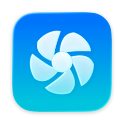
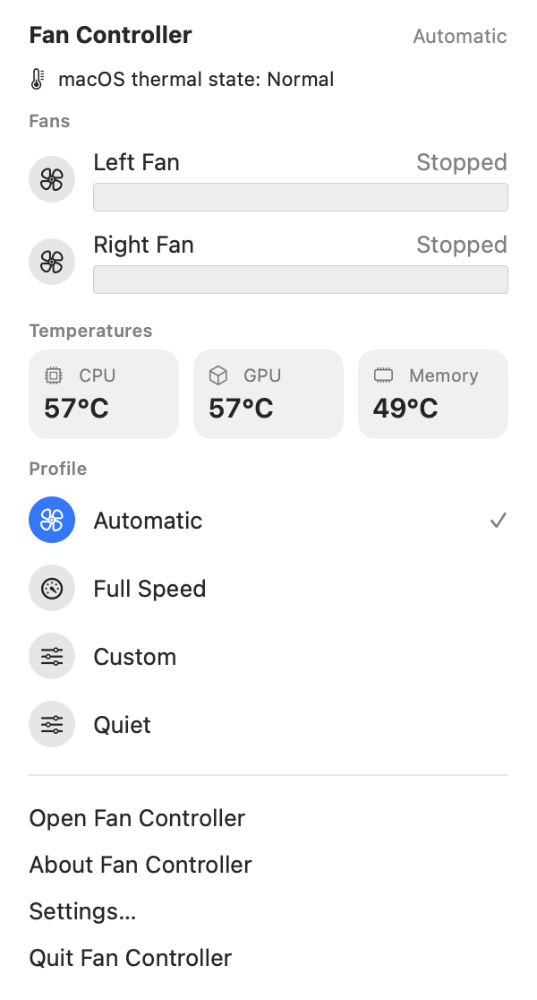
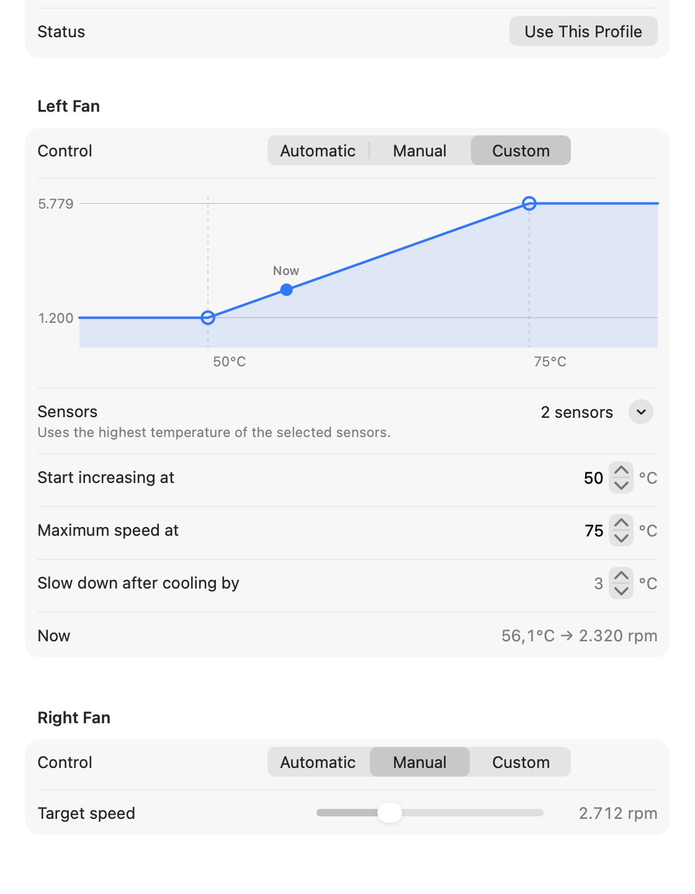
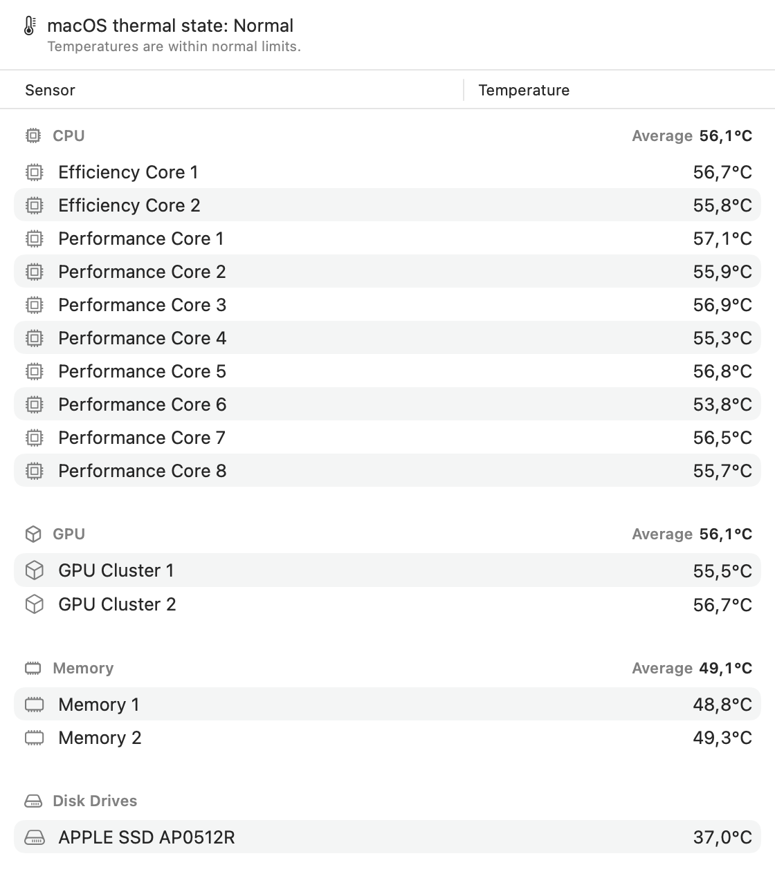

<p align="center">
  
</p>

# Fan Controller

A native macOS app that shows your Mac's fan speeds and temperatures and lets you control the fans: by hand, with your own temperature curves, or automatically by situation.

Written in Swift and SwiftUI, designed to follow Apple's Human Interface Guidelines, with no third-party dependencies.

<p align="center">
  <picture>
    <source media="(prefers-color-scheme: dark)" srcset="docs/images/menu-bar-panel-dark.png">
    
  </picture>
  &nbsp;&nbsp;
  <picture>
    <source media="(prefers-color-scheme: dark)" srcset="docs/images/profile-editor-dark.png">
    
  </picture>
</p>

## Features

**Monitoring**

- Fan speeds with their range, live every 2 seconds
- CPU cores, GPU clusters, memory, SSD (by model name), battery, charger, Wi-Fi, trackpad, airflow and power manager temperatures, in a sortable table grouped by component
- Readings turn red as they approach each sensor's limit, with a warning symbol at the limit
- macOS's own thermal state (Normal, Fair, Serious, Critical)
- A menu bar item with a temperature and fan speeds of your choice, and a panel with live gauges

**Fan control**

- Per fan: **Automatic**, **Manual** (a fixed speed) or **Custom** (a temperature curve)
- Custom curves follow one or several sensors (the hottest wins), can be dragged on a chart, and use hysteresis so the fan doesn't keep speeding up and slowing down
- Profiles: built-in Automatic, Full Speed and Custom, plus your own, which you can export and share as files
- Automatic profile switching on battery, on the power adapter, or while an app is open
- Temperature alerts as notifications

**Safety**

- Only a tiny root helper writes to the SMC, and it accepts commands only from this app, signed by the same team
- Every requested speed is clamped to the fan's own range
- Quitting or a crash returns the fans to automatic

<p align="center">
  <picture>
    <source media="(prefers-color-scheme: dark)" srcset="docs/images/temperatures-dark.png">
    
  </picture>
</p>

## Requirements

- macOS 14 Sonoma or later
- A Mac with Apple Silicon. Tested on a 14-inch MacBook Pro with M1 Pro; other Apple Silicon Macs show their fans and common sensors, and their chip-specific sensors are added as people report them. See [supported models](docs/supported-models.md).

## Download

Fan Controller is in beta. Download `FanController-<version>.dmg` from the [releases](https://github.com/furkansenturk/mac-fan-controller/releases), open it and drag **Fan Controller** to Applications.

During the beta, releases aren't signed with a Developer ID or notarized, so macOS says it can't verify the app and won't open it. Remove the quarantine flag once after installing:

```sh
xattr -dr com.apple.quarantine "/Applications/Fan Controller.app"
```

Or open it once, then choose **Open Anyway** in **System Settings › Privacy & Security**. This step goes away once releases are signed with a Developer ID.

The download shows every sensor, but can't control fans: it isn't signed by a developer team, which the fan control helper requires. Build from source for fan control. See [docs/building.md](docs/building.md#the-released-app-is-ad-hoc-signed).

## Build from source

```sh
git clone https://github.com/furkansenturk/mac-fan-controller.git
cd mac-fan-controller
open FanController.xcodeproj
```

Building needs Xcode 26 or later. Choose the **FanController** scheme and run it. Reading works right away; fan control needs the app signed with your own team, which a free Apple ID provides. See [docs/building.md](docs/building.md#code-signing).

## Documentation

- [Architecture](docs/architecture.md): components, data flow, profiles, the UI
- [SMC keys](docs/smc-keys.md): the sensors, where their names come from, and the temperature limits
- [Security](docs/security.md): why there is a root helper and how it is protected
- [Supported models](docs/supported-models.md): tested Macs and how to add yours
- [Building](docs/building.md): building, signing, testing and releasing

## Contributing

Contributions are welcome, especially sensor maps for Macs that haven't been tested yet. Read [CONTRIBUTING.md](CONTRIBUTING.md) first.

## License

[MIT](LICENSE) © Furkan Şentürk · [furkansenturk.com](https://furkansenturk.com)
