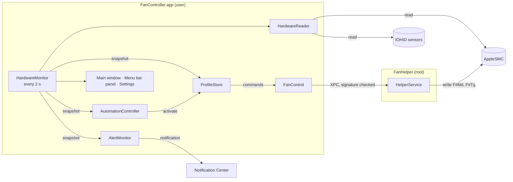
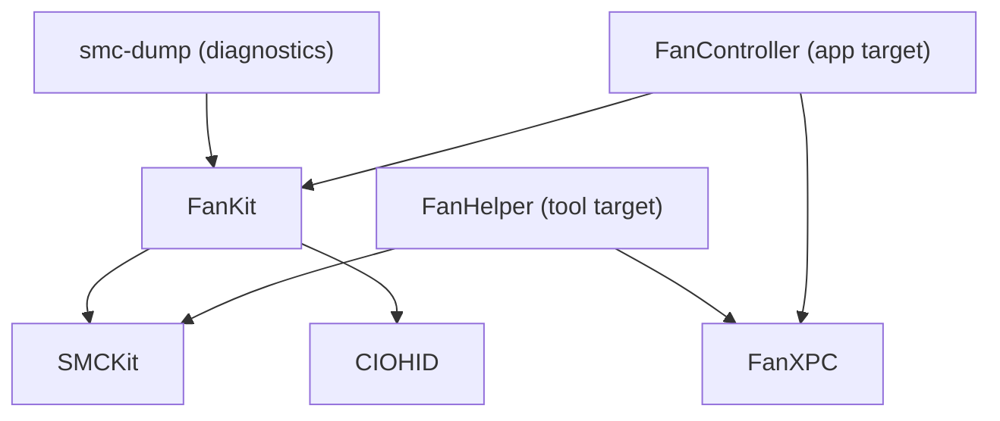

# Architecture

Fan Controller has two executables and one Swift package:

| Component | Runs as | Responsibility |
| --- | --- | --- |
| `FanController.app` | the logged-in user | The whole UI, reading fans and sensors, profiles, automation and alerts |
| `FanHelper` | root, launched by `launchd` | Writing fan mode and target speed to the SMC, nothing else |
| `Packages/FanKit` | linked into both | SMC and IOHID access, domain models, the XPC contract |

Reading the SMC works without privileges, so the app reads it directly. Only writes need root, and the helper does nothing except those writes. See [security.md](security.md).

## Overview



## Modules



| Module | Knows about | Does not know about |
| --- | --- | --- |
| `SMCKit` | IOKit, the `AppleSMC` user client, key and data type encoding | Fans, sensors, UI |
| `CIOHID` | C declarations of the IOHIDEventSystemClient API, which IOKit exports without public headers | Everything else |
| `FanKit` | Fans, sensors and their catalog, IOHID sensors, profiles and rules, automation rules, alerts, thermal limits, `HardwareReader` | XPC, UI |
| `FanXPC` | `FanHelperProtocol` and the shared identifiers | SMC, UI |

The rules behind this split:

- **IOKit stays at the edges.** `SMCKit` talks to the SMC. `CIOHID` declares the HID functions in C with `CF_RETURNS_RETAINED`, so Swift's ARC releases what they return. FanKit's `InternalDisk` reads the SSD's model name from the I/O Registry once at launch. Everything else works with typed values such as `SMCKey`, `TemperatureSensor` and `Fan`.
- **The helper stays small.** It links `SMCKit` and `FanXPC` only, so the code that runs as root fits on a couple of screens and is easy to audit.
- **The app never writes to the SMC.** All writes go through `FanHelperProtocol`.
- **Logic lives in the package**, so `swift test` covers it without Xcode's UI: decoding, rules, curves, hysteresis, automation matching, alert re-arming, limits, export format.

## Reading

1. `HardwareMonitor` (main actor, `@Observable`) creates a `HardwareReader` when the app launches.
2. `HardwareReader` (an actor) opens the SMC once, counts the fans (`FNum`) and asks `SensorCatalog` which temperature keys apply to this chip. It also reads the sensors Apple Silicon exposes only through IOHID: the SSD, the battery's fuel gauge and the power management IC. See [smc-keys.md](smc-keys.md).
3. Every 2 seconds the monitor awaits `reader.snapshot()`, which reads every fan and sensor in one pass and returns a `HardwareSnapshot`.
4. The monitor publishes the snapshot to the UI and hands it to its handlers, in this order:

| Handler | What it does with each snapshot |
| --- | --- |
| `ProfileStore` | Drives the fans to match the active profile |
| `AutomationController` | Switches profiles when the matching rule changes (on battery, on the power adapter, while an app is open) |
| `AlertMonitor` | Posts a notification when a temperature crosses an alert's limit; re-arms 5 °C below it |

Alongside the snapshots, `ThermalStateMonitor` follows macOS's own assessment, `ProcessInfo.thermalState`.

## Profiles

A **profile** is a named set of fan rules (`FanKit/Profiles.swift`). Each fan follows one rule; fans without a rule of their own follow the profile's default rule. Rules are keyed by fan index, so a profile made on one Mac works on any Mac with the same number of fans.

| Rule | In the UI | Meaning |
| --- | --- | --- |
| `automatic` | Automatic | The SMC chooses the speed. |
| `constant(fraction:)` | Manual | A fixed point in the fan's range: 0 is its minimum, 1 its maximum. A fraction, so one profile suits fans with different ranges. |
| `sensorBased(SensorRule)` | Custom | Minimum speed at or below `lowerCelsius`, maximum at or above `upperCelsius`, linear in between. |

A `SensorRule` follows one or more temperature sources and uses the hottest of them. A source is a single sensor or a group summary (the hottest or the average of the CPU cores, GPU clusters or memory). Two safeguards:

- **Hysteresis.** Rising temperatures are followed immediately; falling ones only once they are `hysteresisCelsius` (default 3 °C) below the temperature the fan last followed. The fan doesn't speed up and slow down over and over around one value.
- **No reading, full speed.** If none of a rule's sources has a reading, the fan runs at its maximum.

Three profiles are built in and can't be deleted:

| Profile | Editable | Notes |
| --- | --- | --- |
| **Automatic** | No | The default. Every fan automatic. While it is active the app sends no commands, so the helper isn't installed until someone asks for fan control. |
| **Full Speed** | No | Every fan at `constant(fraction: 1)`. |
| **Custom** | Yes | The working profile. A change made on a fan's own page always lands here: if another profile is active, Custom first takes over that profile's rules, so only the changed fan behaves differently. **Save as New Profile** keeps what was set up here. |

`FanProfile.isBuiltIn` (can't be deleted) and `isEditable` (rules can change) keep these apart. People's own profiles are stored as JSON in `UserDefaults` under `customProfiles`, the Custom profile's rules under `workingProfile`, and the active profile under `activeProfileID`.

Profiles are exported and imported as JSON (`ProfileExport`): a format marker and a version around the profile. An imported profile gets a new ID, and a number if its name is taken.

## Writing

`ProfileStore` decides what each fan should do; `FanControl` installs the helper and delivers the commands. Both run on the main actor.

1. For each fan, `ProfileStore.apply(_:)` asks the active profile's rule for a target speed. It sends a command only when something differs: `setFanAutomatic` when the rule is automatic but the fan is manual, and `setFanSpeed` when the fan is automatic or its target is 50 rpm or more away. A fan with a command in flight is skipped; a fan whose last command failed is retried after 10 seconds.
2. The first command makes `FanControl` register the helper with `SMAppService.daemon(plistName:)`. macOS asks the person to turn it on in System Settings › General › Login Items; until then the fan and profile pages show an inline "Allow fan control" section.
3. `FanControl` connects to the Mach service `com.furkansenturk.FanController.Helper` and keeps the connection open while the app runs. Every call times out after 5 seconds, so a helper that launchd can't start is reported as *Not responding* instead of hanging.
4. The helper checks the caller's code signature: our bundle identifier, signed by our team.
5. `setFanSpeed` writes `F<n>Md = 1` (manual) and `F<n>Tg = rpm`, clamped to `F<n>Mn…F<n>Mx`. It refuses the request if that range can't be read.
6. After each command `FanControl` calls `HardwareMonitor.refresh()`, so the UI updates at once.
7. When the connection drops (the app quit or crashed) or `launchd` stops the helper, every fan goes back to automatic. The curves run in the app, so Custom rules stop with it.

**Updates.** Replacing the app doesn't replace the helper process that is already running. At launch `FanControl.updateHelperIfNeeded()` compares the helper's `version()` with the app's `CFBundleVersion`. If they differ it sends `exitForUpdate`: the helper refuses further writes, returns every fan to automatic and exits, and `launchd` starts the new binary from the app bundle on the next message, without a new approval.

**One copy at a time.** Each running copy of the app applies its own active profile, so two copies undo each other's commands and the fans speed up and stop over and over. Launch Services normally prevents a second copy, but Xcode's Run and `open -n` don't. At launch `AppDelegate` asks every other running copy to quit; the newest copy wins.

## Temperature limits and thermal state

Each kind of sensor has a **warm** and a **critical** limit (`FanKit/ThermalLimits.swift`; values and reasoning in [smc-keys.md](smc-keys.md#warm-and-critical-limits)). Readings shift toward red from warm to critical and show a warning symbol at critical, so the state isn't carried by color alone.

`ThermalStateMonitor` adds macOS's own view (Normal, Fair, Serious, Critical). Apple Silicon has no public signal for throttling itself, so the wording follows Apple's description: at Serious macOS *may* reduce performance, at Critical it does. The sidebar's dot combines both: Fair or a warm sensor shows it; Serious, Critical or a sensor at its critical limit turns it fully red.

## User interface

### Main window

A `NavigationSplitView`. The sidebar has at most two levels, as the HIG recommends, and each item shows a value at a glance. The window title follows the selection, never the app name.

| Sidebar | Detail |
| --- | --- |
| **Fans**: one item per fan, with its current speed | Live speed and gauge, the active profile, and the fan's **Control: Automatic \| Manual \| Custom**. Changing it switches to the Custom profile, and the page says so |
| **Sensors › Temperatures**, with the hottest CPU reading and a heat dot | macOS's thermal state, then a sortable table with a symbol per sensor. Grouped by component by default (CPU, GPU, Memory, Disk Drives, Other Sensors, with averages); **Group by Component** in the toolbar and the View menu switches to one list. Disks are named after their model, e.g. "APPLE SSD AP0512R" |
| **Profiles**: Automatic and Full Speed marked with a lock, the active one with a check mark | The profile editor |
| **Automation › Profile Switching**, with On or Off | Rules checked top to bottom; the first that applies wins |
| **Automation › Alerts**, with the number of enabled alerts | A sensor and a limit per alert, delivered as notifications |

While the pointer is over the Profiles section, its header shows **New Profile** (+) and **Import Profile…** (⤓), drawn like the header text, as section accessories are in Finder and Notes. They stay reachable with VoiceOver and the keyboard. Profile rows have Use This Profile, Rename (in place, as in Finder), Duplicate, Export… and Delete… in their context menu.

### Profile editor

A Name field (read-only for built-in profiles), a Status row with **Use This Profile** or *In Use*, and one section per fan with **Control: Automatic | Manual | Custom**:

- **Manual**: a target speed slider in 50 rpm steps, saved 300 ms after it stops moving. Choosing Manual starts at the fan's current speed, so nothing changes audibly.
- **Custom**: the fan curve (Swift Charts) with a dot at the current reading. Its two corners can be dragged sideways; the "Now" dot follows while dragging. Below it, **Sensors** (one menu with check marks; the hottest selected sensor is used), **Start increasing at**, **Maximum speed at**, **Slow down after cooling by** (hysteresis) and a live **Now** row such as "55,1 °C → 2.140 rpm".

Automatic and Full Speed offer **Duplicate to Customize**; Custom offers **Save as New Profile**.

### Menu bar

The menu bar item shows the fan symbol and, by choice in Settings › Menu Bar, a temperature and fan speeds. Clicking it opens a panel in the style of the system's own (Wi-Fi, Battery): macOS's thermal state, live fan gauges, CPU, GPU and memory tiles, the profile list, and Open, About, Settings and Quit. A panel rather than a menu because it holds live, richer content and keeps updating while open (HIG › The menu bar › Menu bar extras).

Closing the main window keeps the app running in the menu bar; Quit (⌘Q) ends it. With the menu bar item hidden, closing the window quits, so the app is never left running with no way back.

### Settings

| Pane | Contents |
| --- | --- |
| **General** | Temperature unit (Automatic follows the system), language (System, English, Türkçe; a restart is offered in place), show icon in Dock, open at login |
| **Menu Bar** | Show in menu bar, icon, the temperature shown, fan speeds |
| **Fan Control** | The helper's status and whether it responds; Open Login Items, Reinstall, Remove |

The Dock icon and the menu bar item can't both be hidden.

### About

Fan Controller › About Fan Controller and the menu bar panel open an About window: icon, version, a short description, this Mac's chip, fan count and macOS version as selectable text for bug reports, and links to the website and the repository.

### Menus

The **Fans** menu lists the profiles, **Set All Fans to Automatic** (⌥⌘A), **New Profile** (⌘N), **Duplicate Profile** (⌘D), **Rename Profile**, **Import Profile…**, **Export Profile…** and **Delete Profile…**. Commands that don't apply are disabled, not hidden. **View › Group by Component** toggles the Temperatures grouping.

## Bundle layout

```
FanController.app/
└── Contents/
    ├── MacOS/
    │   ├── FanController
    │   └── FanHelper
    ├── Library/
    │   └── LaunchDaemons/
    │       └── com.furkansenturk.FanController.Helper.plist
    └── Resources/
        ├── AppIcon.icns          (macOS 14–15)
        └── Assets.car            (Liquid Glass icon, menu bar icon)
```

## Repository layout

```
App/
  Features/          Alerts, Automation, About, Fans, MenuBar, Profiles, Sensors, Settings, Sidebar
  Services/          HardwareMonitor, FanControl, ProfileStore, AutomationController, AlertMonitor, …
  Resources/         AppIcon.icon, Assets.xcassets, Localizable.xcstrings
Helper/              Privileged helper target and its launchd plist
Packages/FanKit/     SMCKit, CIOHID, FanKit, FanXPC, smc-dump and their tests
Config/              xcconfig files (Base, App, Helper, Signing)
Scripts/             dump-sensors.sh, generate-icon-layers.py
docs/                This documentation
```

## Decisions

- **No desktop widget.** A WidgetKit widget was built and removed. macOS draws widgets from timelines and limits how often an app may ask for a reload, so readings would lag by 15–60 seconds or more. The menu bar item, updated every 2 seconds, is the live glance instead.
- **Automation and alerts in the main window, preferences in Settings.** Rules and alerts are content people come back to, so they live in the sidebar. The unit, language, Dock and menu bar options are set once and stay in the Settings window (HIG › Settings).
